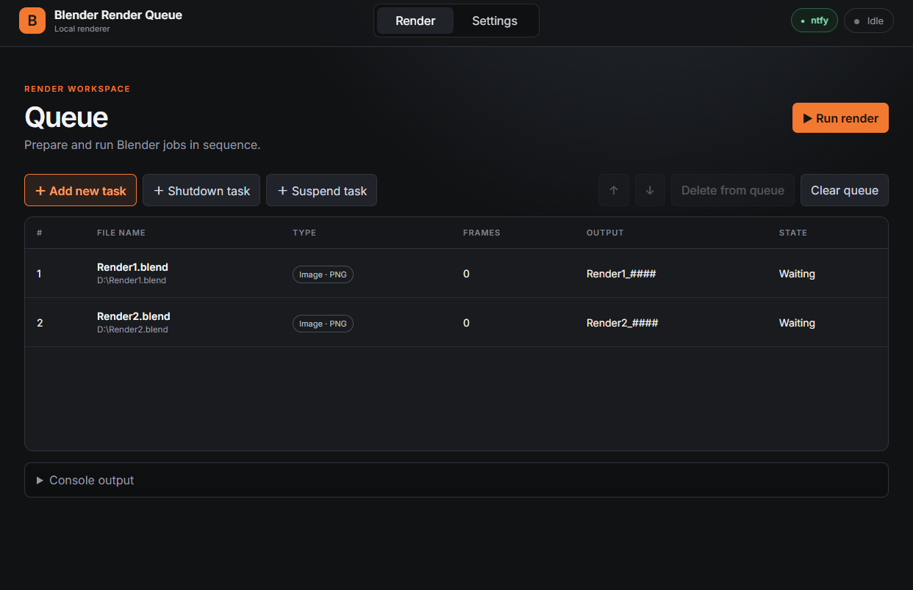

# BlenderCMD Render GUI

A lightweight, local browser interface for preparing and running sequential Blender renders. It replaces manually maintained batch files with a visual queue, progress tracking, configurable output formats, optional ntfy.sh notifications, and end-of-queue power actions.

The server listens on `127.0.0.1` only. No authentication, database, framework, or third-party Python package is required.

[**Open the interactive demo →**](https://rbaszak.github.io/blendercmd-gui/)



## Features

- Queue still-image and animation renders from `.blend` files
- Multi-select queue rows with click, `Ctrl`/`Cmd`, or `Shift`
- Edit, duplicate, inspect, open output, and delete tasks from a right-click context menu
- Reorder queued tasks with drag and drop or the arrow buttons, including moving a selected group together
- Still formats: JPEG, PNG, OpenEXR
- Animation formats: PNG sequence, MP4 (H.264), and WebM (VP9)
- Separate output directories and custom Blender arguments for stills and animations
- Animation output stored in a per-project subdirectory
- Detect completed output files when the application starts
- Skip existing frames in a partially rendered PNG sequence or overwrite the complete range
- Live Blender console output, whole-number tile/sample progress, and remaining-time estimate
- Preflight validation of Blender, source files, frame ranges, output paths, and free space
- Persistent `Failed` and `Cancelled` states with an explanatory tooltip
- Optional rotating logs for application errors and complete Blender output
- Asynchronous ntfy.sh notifications after successful renders
- Optional shutdown or suspend task at the end of the queue
- Windows tray icon and background launch
- First-run detection and automatic saving of Blender and local output defaults
- Linux and macOS launch scripts with terminal-based shutdown
- Dark and light themes with the last selection saved in the browser
- Configurable server host and port
- Configuration and queue persistence in YAML

## Requirements

- Python 3.9 or newer
- Blender with command-line rendering support
- Tkinter on Linux/macOS for native file and directory dialogs
- curl for ntfy.sh notifications

See [DEPENDENCIES.md](DEPENDENCIES.md) for installation commands on Ubuntu/Debian, Fedora, Arch Linux, and macOS.

No packages from PyPI are required. `requirements.txt` is intentionally empty.

Release history is documented in [CHANGELOG.md](CHANGELOG.md).

## Installation

```bash
git clone https://github.com/rbaszak/blendercmd-gui.git
cd blendercmd-gui
cp configuration-example.yaml configuration.yaml
```

On Windows, copy the configuration with Explorer or PowerShell:

```powershell
Copy-Item configuration-example.yaml configuration.yaml
```

Edit the Blender and output paths, or set them later from the Settings page.

## Running

### Windows

Double-click `start-windows.bat`. The application starts without a console window, opens the browser, and remains available from the Windows system tray.

Use the tray menu's **Exit** action to stop the server. Closing the browser tab does not stop the application.

### Linux

```bash
chmod +x start-linux.sh
./start-linux.sh
```

Keep the terminal open and press `Ctrl+C` to stop the application safely.

### macOS

```bash
chmod +x start-macos.command
./start-macos.command
```

The interface is available at [http://127.0.0.1:5050](http://127.0.0.1:5050).

## Configuration

Release archives include a clean `configuration.yaml` with empty Blender and output paths. On first launch, the application prompts you to open Settings and complete these required paths. Example values remain available only in `configuration-example.yaml`.

The queue validates saved `.blend` paths before rendering. Missing files are marked in red with a `File missing` state, and rendering remains disabled until the queue is corrected.

Runtime configuration is stored in `configuration.yaml`. This file is ignored by Git because it can contain private paths, an ntfy.sh server/topic, and the current render queue.

Start from [configuration-example.yaml](configuration-example.yaml):

```yaml
server:
  host: "localhost"
  port: 5050
settings:
  blenderPath: "/usr/bin/blender"
  imageOutputPath: "/home/user/Renders/Images"
  animationOutputPath: "/home/user/Renders/Animations"
  imageCustomArguments: ""
  animationCustomArguments: ""
notifications:
  enabled: false
  server: "https://ntfy.sh"
  topic: ""
logging:
  enabled: false
queue: []
```

The server defaults to `localhost:5050`. Change `server.host` or `server.port` before starting the application if another bind address or port is needed. Binding to a non-loopback address exposes an unauthenticated interface, so only do this on a trusted network with appropriate firewall rules.

The built-in parser supports the structure generated by this application. Advanced YAML features such as anchors, aliases, and multiline scalars are not supported.

Set `logging.enabled` to `true` and restart the application to write complete Blender output and unexpected application errors to `logs/blendercmd-gui.log`. Logs rotate at 5 MB and retain three backups.

### Custom Blender arguments

Custom arguments are inserted before the render trigger (`-f` or `-a`). For example:

```text
--threads 8 --cycles-device CUDA
```

### ntfy.sh notifications

```yaml
notifications:
  enabled: true
  server: "https://ntfy.example.com"
  topic: "blender"
```

After each successful render, the application sends:

```text
Title: Render Finished
Body: Scene.blend
```

Delivery is asynchronous and a notification failure does not stop the render queue.

## Output layout

Still images are written directly to the image output directory. Animations use a subdirectory named after the `.blend` file:

```text
Images/Scene_0000.png
Animations/Scene/Scene_0001.png
Animations/Scene/Scene_0002.png
Animations/Scene/Scene.mp4
Animations/Scene/Scene.webm
```

Blender's bundled FFmpeg support is used for MP4 and WebM. A separate FFmpeg executable is not required.

## Power actions

Only one shutdown or suspend task can be queued at once. It is automatically kept at the end and cannot be edited or duplicated. These tasks execute real operating-system actions when reached. Linux actions use `systemctl` and may require appropriate permissions. macOS may request permission to control System Events.

If Blender exits with an error, the queue stops before later tasks are executed. Exiting the application also terminates an active Blender process.

## Queue controls

- Click selects one row; `Ctrl`/`Cmd`+click toggles rows; `Shift`+click selects a range.
- Right-click opens the task menu. Render tasks can be edited, duplicated, or given a fully customized Blender command.
- `Ctrl`/`Cmd`+`A` selects the complete queue, `Delete` removes the selection, and `Escape` closes the active menu or dialog.
- Keyboard shortcuts are disabled while typing or while another dialog is open.

## Security

The application is intended for a trusted local computer. By default it binds to `localhost` and does not expose the interface to the local network or internet. The bind address is configurable, but the application does not provide authentication.

Do not commit `configuration.yaml`; use `configuration-example.yaml` for public examples.

## Project structure

```text
app.py                       Local HTTP server and Blender runner
static/                      Browser interface
configuration-example.yaml  Public configuration template
start-windows.bat / .vbs    Windows launcher and background helper
start-linux.sh              Linux launcher
start-macos.command         macOS launcher
tray.ps1                     Windows tray integration
DEPENDENCIES.md              Platform dependency instructions
```

## License

Licensed under the [MIT License](LICENSE). Copyright © 2026 Rafał Baszak.

## Development note

This application was vibe-coded with the help of Codex AI.
